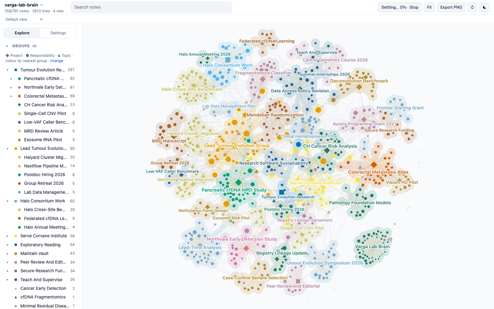

# Varga Lab Brain

A demo Second Brain: about 800 linked Markdown notes holding the working memory of a fictional cancer genomics and molecular epidemiology lab. Clone it, open the folder, and explore what a vault looks like after two years of daily use: projects, decisions, meetings, people, papers, open questions, and the links between them.



> [!warning]
> Everything about the lab is fictional: the Corvane Institute, every person, the cohort, registry, hospitals, consortium, funders, journals, studies and results. Any resemblance to real people or organisations is accidental. Only the literature Sources marked as scientific papers are real.

## What it shows

The vault was deployed from the [Second Brain template](https://github.com/mfoll/second-brain-template), which adds operating rules, workflows and a decision record to the [Portent](https://github.com/refactoringhq/portent) note model. Everything is plain files: Markdown notes with YAML frontmatter, typed relationships (`belongs_to`, `related_to`, `has`) and wikilinks. No app, database or index is required.

| Area | What to look at |
| --- | --- |
| Structure | 8 Responsibilities at the root, 36 Projects under them, 11 Topics as lateral context; every note rolls up to a Responsibility. |
| Memory | 326 Sources, 73 Events, 51 Questions, 42 Concepts, 21 Opinions, 20 Recaps, 60 people. |
| Real literature | About 130 Sources are real open-access papers, cited with title, authors, DOI and PMID, summarised in our own words from their abstracts. Their "Why It Matters" sections describe how the fictional lab uses them. |
| Operations | `AGENTS.md`, Type notes, Procedures, Skills and ADRs from the template, unchanged except for the deployment steps. |
| History | Git history from January 2025 to October 2026, one commit per month of captures. |

## Open it

- **Any Markdown editor.** Clone the repository and open the folder. Start from [[vault]].
- **[Tolaria](https://tolaria.md/).** Open the folder as a vault for typed sidebars, relationship panels and saved views.
- **[Brain Graph](https://github.com/mfoll/brain-graph).** See the whole vault as a map coloured by project:

  ```bash
  npx github:mfoll/brain-graph path/to/second-brain-demo
  ```

- **A coding agent.** Run Claude Code, Codex or Gemini CLI in the folder. They read [[AGENTS]] (through `CLAUDE.md` and `GEMINI.md` where needed) and follow the vault's Procedures.

## Try this

Each question has a known answer in the vault, so you can check what an agent finds.

| Ask | Where the answer lives |
| --- | --- |
| Why did we drop gradient boosting from the fragmentomics classifier? | A lab meeting dropped it on 2026-03-12; a review on 2026-04-02 partly reversed that. See [[fragmentomics-classifier]] and the daily Recap of 2026-04-02. |
| What is blocking the MRD manuscript revision? | External validation needs Halo consortium data, which needs an institute policy change. See [[mrd-manuscript]]. |
| How do we handle reverse causation in the Northvale lead-time analysis? | A decision on 2026-06-24, with one co-author still disagreeing. See [[how-do-we-handle-reverse-causation-in-the-northvale-lead-time-analysis]]. |
| Do we still need matched buffy coat sequencing? | Still open. See [[do-we-still-need-matched-buffy-coat-sequencing]]. |
| Where else do we use our clonal hematopoiesis calls? | Noise in one study, exposure in another. See [[clonal-hematopoiesis]]. |

Workflows to try with an agent:

- **Resume a project:** "Resume the Northvale Early Detection Study."
- **Process the Inbox:** about ten raw captures from the last week of October 2026 have `_organized: false`; each has an obvious home.
- **Ingest a paper:** give any open-access paper on cell-free DNA or clonal hematopoiesis and ask where it belongs.
- **Lint the vault:** the audits should find one unresolved link, one homeless Concept and one Person reachable only through `has`, all left in on purpose.

## Scope and privacy

The fictional lab's research, group leadership, funding, teaching, institute service, consortium work and peer review. No patient-level data, credentials or personal administration; studies point to governed storage through Source notes. The group's own fictional DOIs use the reserved test prefix 10.5555 and do not resolve.

## Template updates

The vault was deployed from the template on 2026-10-23. Later template improvements can be ported with [[upgrade-existing-vault-from-template|Upgrade an Existing Vault From the Template]], as a reviewed change: an agent proposes each port, and a person approves it. Never run it unattended. A vault in use is expected to differ from the template on purpose, in its ADRs, Procedures, Skills and instructions.

## How it was made

An AI agent drafted the world specification (the institute, people, projects, timeline and the storylines behind the questions above) and a person reviewed and changed it. AI agents then wrote the notes from it, one per area of the lab, and retrieved the real papers from Europe PMC. The links, frontmatter, cross-area consistency and paper metadata were checked with the template's lint scripts and against Europe PMC.

## Storage and backup

Git history in this repository. A demo that edits notes can be reset with `git checkout .` and `git clean -fd`.

## Licence

MIT, see `LICENSE`, which also covers the template material. `THIRD_PARTY_NOTICES.txt` lists upstream notices. Cited papers remain under their own licences; the notes contain only their metadata and our own summaries.
